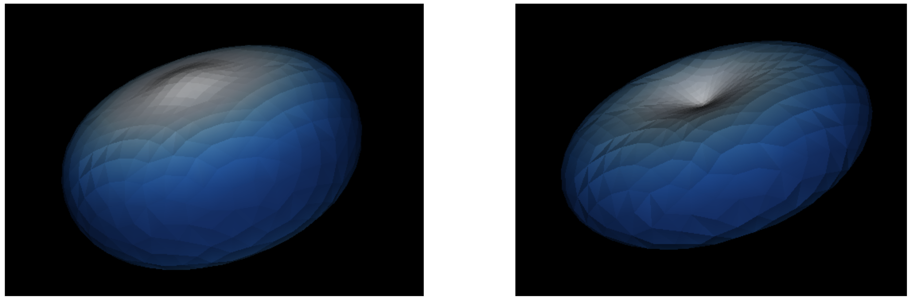

<p align="center">
  
</p>

<h1 align="center">Plot response function</h1>

<p align="center">
  A PNG of the single-fibre response function of a CSD fit, rendered on a sphere for quality control.
</p>

<p align="center">
  <a href="https://github.com/brainlife/abcd-spec"></a>
  <a href="https://doi.org/10.25663/brainlife.app.311"></a>
  <a href="LICENSE"></a>
</p>

## 🧠 At a glance

<!-- brainlife-app:begin (generated from the App manifest; edit the manifest, not this block) -->

> **Renders the single-fiber response function of a CSD fit on a sphere as a PNG image with DIPY/VTK, for quality control of the response estimate.**

Reads response.txt from a CSD output (using the second row when several rows are present), builds an axially symmetric spherical-harmonic response with DIPY and renders it on the symmetric724 sphere off-screen (Xvfb). Use it to check that the response looks like a flat, disc-shaped single-fiber profile; the README shows good versus bad examples.

| | |
|---|---|
| 📥 **Inputs** | `neuro/csd` |
| 📤 **Outputs** | `generic/image/png` |
| 🐳 **Container** | `brainlife/pythonvtk:1.2` |
| ⚙️ **Resources** | 1 CPUs · 8 GB memory · 0.25 h walltime |
| 🔗 **Run it** | [doi.org/10.25663/brainlife.app.311](https://doi.org/10.25663/brainlife.app.311) |

#### 📥 Inputs

| Input | Datatype | Required | Description |
|---|---|---|---|
| `response` | `neuro/csd` | yes | The path to the CSD datatype containing the response function |

#### 📤 Outputs

| Output | Datatype | Description |
|---|---|---|
| `images` | `generic/image/png` | A png of the response function mapped to a sphere |

<!-- brainlife-app:end -->

## 🚀 Running the App

### ☁️ On brainlife.io

Open the App at [doi.org/10.25663/brainlife.app.311](https://doi.org/10.25663/brainlife.app.311), choose a `neuro/csd` dataset and press **Execute**. The App reads its `response.txt` (using the second row when there are several), builds an axially symmetric spherical-harmonic response with DIPY and renders it on a sphere off-screen with VTK. The image is archived to your project as a `generic/image/png` dataset tagged `response_function`.

Use it to check the CSD fit: good fits look like the image on the right above, bad fits like the image on the left.

### 💻 Locally

You need [Singularity/Apptainer](https://apptainer.org/). DIPY, VTK and Xvfb run inside the container.

1. Clone this repository and check out the branch brainlife.io runs: `git checkout v1.0`.
2. Create `config.json` with the path to your response file:

   ```json
   {
       "response": "/input/csd/response.txt"
   }
   ```

3. Run the App:

   ```bash
   ./main
   ```

### 🧪 Sample data

Download sample datasets from brainlife.io with the [brainlife CLI](https://github.com/brainlife/cli):

```bash
npm install -g brainlife
bl login
mkdir input
bl dataset download <dataset-id>
```

## 📦 Outputs

```text
images/
└── response.png   the response function rendered on a sphere
```

## 📚 Citing

> [!TIP]
> If you use this App in your work, please cite the App, the software it builds on and brainlife.io (below). GitHub's **Cite this repository** button gives the App citation in APA and BibTeX.

- Plot response function. brainlife.io App. [doi:10.25663/brainlife.app.311](https://doi.org/10.25663/brainlife.app.311)
- Avesani P, McPherson B, Hayashi S, et al. The open diffusion data derivatives, brain data upcycling via integrated publishing of derivatives and reproducible open cloud services. Sci Data 6, 69 (2019). [doi:10.1038/s41597-019-0073-y](https://doi.org/10.1038/s41597-019-0073-y)
- Garyfallidis et al. Dipy, a library for the analysis of diffusion MRI data. *Frontiers in Neuroinformatics* 8 (2014). [doi:10.3389/fninf.2014.00008](https://doi.org/10.3389/fninf.2014.00008)
- Hayashi S, Caron BA, Heinsfeld AS, et al. brainlife.io: a decentralized and open-source cloud platform to support neuroscience research. *Nature Methods* 21:809–813 (2024). [doi:10.1038/s41592-024-02237-2](https://doi.org/10.1038/s41592-024-02237-2)

## 👥 Authors

- Brad Caron
- Paolo Avesani

**Contributors:** Soichi Hayashi, Franco Pestilli

## 💰 Funding

[](https://wellcome.org/)
[](https://reporter.nih.gov/project-details/11261037)
[](https://reporter.nih.gov/project-details/11411328)
[](https://reporter.nih.gov/project-details/10262925)
[](https://reporter.nih.gov/project-details/10428625)
[](https://reporter.nih.gov/project-details/10460628)
[](https://reporter.nih.gov/project-details/11140284)
[](https://www.nsf.gov/awardsearch/showAward?AWD_ID=1734853)
[](https://www.nsf.gov/awardsearch/showAward?AWD_ID=2203524)
[](https://www.nsf.gov/awardsearch/showAward?AWD_ID=1636893)
[](https://www.nsf.gov/awardsearch/showAward?AWD_ID=2148729)
[](https://www.nsf.gov/awardsearch/showAward?AWD_ID=1912270)
[](https://www.nsf.gov/awardsearch/showAward?AWD_ID=2148700)
[](https://www.nsf.gov/awardsearch/showAward?AWD_ID=1916518)

<sub>brainlife.io is publicly funded, and acknowledging that support helps keep it running. This App was developed with support from Wellcome, the U.S. National Institutes of Health (including the BRAIN Initiative BRAIN CONNECTS program: The Axonal Projectome EXchange, U24NS140384, and the Center for Mesoscale Connectomics, UM1NS132207) and the U.S. National Science Foundation.</sub>

## ⚖️ License

[MIT](LICENSE).
